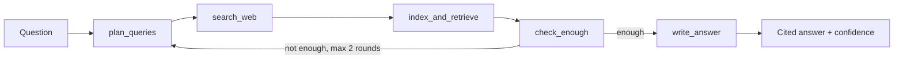

A research agent that answers questions about a company or topic using the web.
It searches, reads several pages, compares what they say, and returns a
**cited answer with a confidence level**. When sources disagree, it tells you.

Built with LangGraph, LangChain, Tavily and Chroma.

Searching for company information is slow and unreliable. Different sites give
different numbers, many "company profile" sites copy each other, and a normal
chatbot answers confidently without showing where the facts came from.

This agent tries to fix three things:
1. Every claim has a citation you can click.
2. Sources are ranked, so an official website beats a data-aggregator site.
3. Confidence is checked by code rules, not only by the LLM's own guess.

How it works - 



| Step | What it does |
|---|---|
| plan_queries | LLM writes 3 queries (official source, news, another angle) and guesses the official website |
| search_web | Tavily search, plus one search restricted to the official website |
| index_and_retrieve | Splits pages into chunks, stores them in Chroma, keeps the best 8 chunks. Trusted sources come first |
| check_enough | LLM decides if the evidence is enough. If not, it writes new queries and the agent searches again |
| write_answer | Writes the answer with citations, lists conflicts, then code checks citations and sets the confidence |

These rules are plain Python in `trust.py`, not prompts:

- **Source trust levels:** official > reputable (news, reference) > other > aggregator.
- **Citation check:** if the answer has no `[1]` style citations, the agent retries once. Only sources that were really cited are listed.
- **Confidence can only go down.** The LLM guesses a level, then code lowers it if: fewer than 3 different websites are cited, no official or reputable source is cited, all sources are aggregator sites, or sources conflict.
- **Honest gaps:** the prompt tells the model to write "not found in the sources" instead of guessing.

SETUP
You need Python 3.10+ and two free API keys: [Groq](https://console.groq.com) (LLM) and [Tavily](https://tavily.com) (web search).

```bash
git clone https://github.com/YOUR_USERNAME/enterprise-knowledge-agent.git
cd enterprise-knowledge-agent

python -m venv venv

pip install -r requirements.txt

cp .env.example .env     
# open .env and paste your GROQ_API_KEY and TAVILY_API_KEY
```

```bash
python agent.py "How many employees does EdgeVerve have?"
```

```bash
python run_tests.py
```

Runs 6 questions: narrow facts, questions where sources usually disagree
(employee counts, revenue), and one trap question that has no public answer
(the correct behaviour is "not found" with Low confidence). Results are saved in
`results.json`.

Being honest about these:

- Dates are not read. The agent can use an old page and present outdated facts as current. Reading publish dates is the next improvement.
- "Official source" detection is simple. It checks whether the website name appears in the question or matches the LLM's guess of the official domain.
- Conflict handling depends on the LLM. The code checks citations and confidence, but the decision on which conflicting source is right is still made by the model, guided by the trust order.
- Free-tier limits. Groq and Tavily free tiers have rate limits, so long test runs are slow.
- Not independently verified. Always click the cited sources for important decisions.


```
agent.py          LangGraph agent (the 5 steps)
trust.py          source trust, citation check, confidence rules
run_tests.py      runs the test questions
requirements.txt
.env.example
```
- Read publish dates and prefer newer sources
- Add a second tool: search private documents (PDFs) stored in Chroma
- Streamlit UI that shows each agent step live
- Larger evaluation set with checked answers and accuracy numbers


